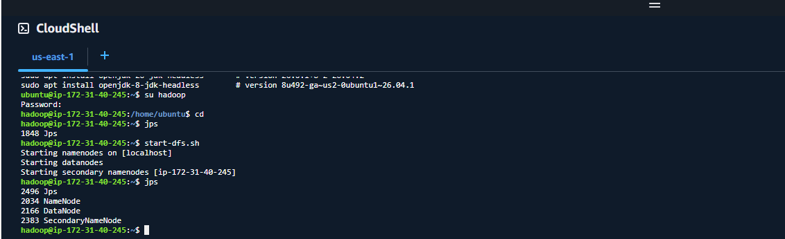

## 1. Conexión y estado de los servicios.
Captura de la sesión SSH abierta en la máquina remota ejecutando el comando. Debe mostrarse la presencia de los procesos activos de Hadoop (NameNode, DataNode, SecondaryNameNode, ResourceManager y NodeManager).

