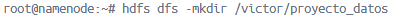
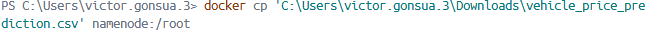
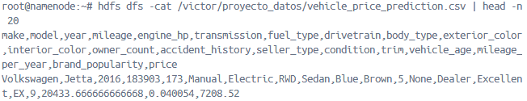
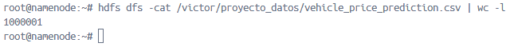
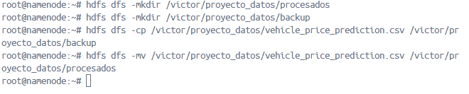
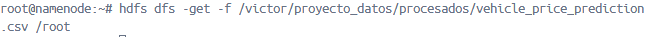
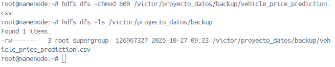
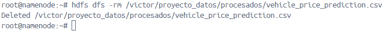

## Ejercicios

# Preparación del entorno

## 1.- Crea un directorio personal en HDFS bajo /user con tu nombre de usuario y dentro de él un directorio llamado proyecto_datos.

## 2.- Carga de datasets

Descarga el dataset Automotive Price Prediction Dataset que puedes obtener desde Kaggle y que contiene un dataset sintético con información y precio de 1000000 de vehículos de segunda mano
Desde tu sistema local, sube al directorio proyecto_datos el dataset que has descargado.

## 3.- Exploración de datos

Visualiza el contenido del archivo directamente en HDFS.
Obtén el número de líneas del dataset.

## 4.- Organización del proyecto

Crea un subdirectorio /procesados y otro backup dentro de tu carpeta de proyecto.
Copia el archivo original a backup.
Mueve el archivo original de proyecto_datos a procesados.
Colaboración en el equipo

## 5.- Crea un directorio compartido bajo /compartido (si no existe) y copia allí tu dataset para que otros puedan acceder.

## 6.- Recuperación de datos
Descarga a tu sistema local el archivo que está en el directorio procesados.
Control de accesos

## 7.- Verifica los permisos de tus archivos.
Cambia los permisos de un archivo de backup para que solo tú tengas acceso de lectura y escritura.

## 8.- Mantenimiento

Elimina un archivo temporal que hayas subido por error a tu espacio en HDFS.

